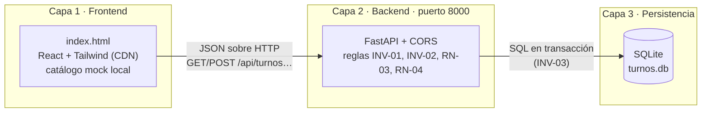
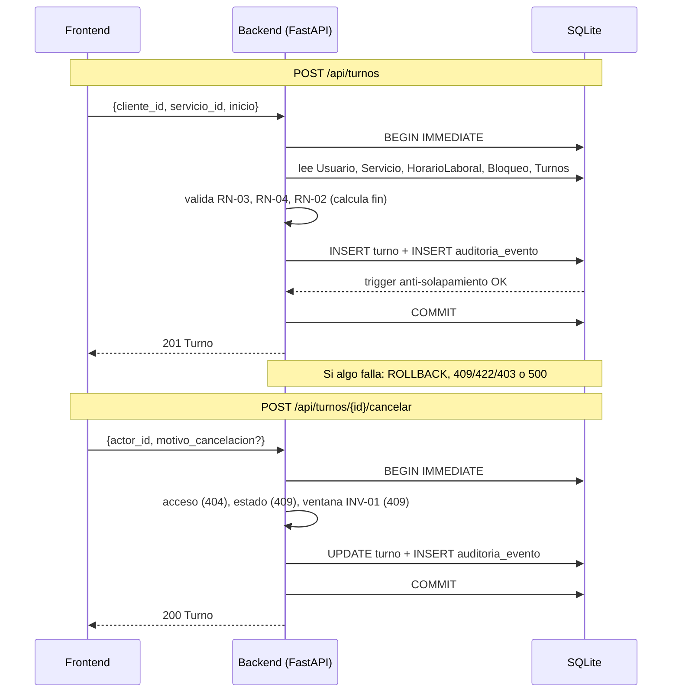

# plan.md — Arquitectura desacoplada de 3 capas (Fase 2)

| Campo | Valor |
|---|---|
| Versión del plan | 2.0.1 (la 1.0.0 está en el [Anexo A](#anexo-a--plan-v1-fase-1-prototipo-conceptual)) |
| Base normativa | [spec.md](spec.md) v0.2.1 (INV-01, INV-02, INV-03 y contrato REST de §11) |
| Fecha | 2026-11-06 |
| Estado | Aprobado (decisiones D-06 a D-09 incluidas). No se escribió código todavía. |

## 1. Objetivo de la Fase 2

Pasar del prototipo conceptual (`index.html` en su versión actual, todo en memoria del navegador) a una arquitectura desacoplada en la que **los turnos persisten de forma atómica en una base de datos relacional** (INV-03) y las reglas INV-01 e INV-02 las aplica un servidor, no la pantalla.

Alcance: solo los 3 endpoints de [spec.md §11](spec.md). Todo lo demás queda fuera (spec §11.1).

## 2. Por qué se desacopla: la memoria volátil de JS viola la integridad del sistema

En `index.html` el estado vive en el `useReducer` del navegador y el plan v1 lo decidió así a propósito (decisión 5: «Persistencia: No»). Eso sirvió para validar la experiencia de uso, pero incumple el contrato del sistema en estos puntos:

| # | Problema del almacenamiento en memoria de JS | Regla del spec que viola | Qué lo resuelve en v2 |
|---|---|---|---|
| 1 | **Se pierde al recargar o cerrar la pestaña.** Los datos vuelven al estado inicial. | INV-03 (durabilidad); RN-06 (el historial es inmutable) | Capa 3: SQLite en `turnos.db`; el estado sobrevive al reinicio del backend. |
| 2 | **Cada pestaña o navegador tiene su propia copia.** Dos clientes en dos navegadores reservan el mismo slot y ambos «ganan»; no existe un árbitro único. | INV-02 / RN-02 (no solapamiento) | Una única base de datos, con una sola copia de la verdad. |
| 3 | **La concurrencia es simulada.** El reducer procesa las acciones una detrás de otra en un solo hilo; no demuestra atomicidad real (el README ya lo lista como límite). | RN-02 («una validación solo en la aplicación NO es suficiente») | Transacción `BEGIN IMMEDIATE` más un *trigger* en la base de datos (spec §11.5). |
| 4 | **Las reglas viven en el cliente.** Cualquiera puede alterar el estado o saltar el dominio desde las herramientas del navegador. | RBAC-01 («la UI nunca es la barrera de seguridad»); INV-01 | Capa 2: el servidor ejecuta INV-01 e INV-02 y la UI solo muestra los códigos de error. |
| 5 | **No hay escritura transaccional.** Un fallo a mitad de operación puede dejar un turno sin su evento de auditoría. | INV-03 (atomicidad); RN-08 | Turno y `AuditoriaEvento` se escriben en la misma transacción. |
| 6 | **La auditoría es mutable.** Está en el mismo arreglo en memoria que cualquier otro dato. | RN-08 (log inmutable) | El backend no emite `DELETE` sobre `AuditoriaEvento`. |

Desacoplar significa separar **quién muestra** (frontend), **quién decide** (backend) y **quién recuerda** (base de datos), de modo que cada capa pueda fallar, reiniciarse o cambiarse sin corromper a las otras.

## 3. Arquitectura de 3 capas



### 3.1 Capa 1 — Frontend (`index.html`)

- Es el mismo `index.html` de la Fase 1, modificado **en el lugar**: no se crea otro archivo de frontend. La versión conceptual v1 (todo en memoria) queda disponible en el historial de git (commit `7d148be`).
- Para los turnos consume **solo** el contrato de [spec.md §11](spec.md) con `fetch` y JSON sobre HTTP, contra `http://localhost:8000`.
- Los turnos ya no tienen su fuente de verdad en el navegador: la pantalla no decide si algo está permitido, muestra el código de error que devuelve el backend (`SLOT_UNAVAILABLE`, `CANCELLATION_WINDOW_EXPIRED`, etc.).
- **Datos mock locales (decisión D-08, aprobada):** el catálogo de servicios, los profesionales y los horarios siguen siendo datos mock dentro del HTML, con los mismos `id` que la carga inicial de la base de datos. La grilla de slots se calcula con esos datos y con `GET /api/turnos`, y el backend siempre revalida.
- Todo lo que el contrato no cubre (bloqueos, métricas, auditoría, servicios, emails, completar y marcar ausente) sigue siendo mock local y **no persiste**. Esas funciones no deben modificar los turnos que vienen de la API.

### 3.2 Capa 2 — Backend (Python + FastAPI, puerto 8000)

- Aplicación FastAPI servida con `uvicorn` en el **puerto 8000**.
- **CORS habilitado** con `CORSMiddleware`. Como el frontend puede abrirse con doble clic (`file://`, origen `null`) y la API no usa cookies ni credenciales, en desarrollo se permiten todos los orígenes (`allow_origins=["*"]`). Es una decisión solo para desarrollo local; para producción se restringe al origen real.
- Implementa los 3 endpoints del contrato y el dominio en Python: INV-01 (`canClientCancel`), INV-02 (solapamiento `[inicio, fin)`), RN-03, RN-04 y RN-06. Es una traducción de las funciones puras que ya existen en el bloque `domain/` de `index.html`.
- `ahora` es un parámetro del dominio (el endpoint lo toma del reloj real en UTC), de modo que las pruebas puedan inyectar cualquier instante (D-09).
- Acceso a datos con el módulo estándar `sqlite3` y SQL explícito, sin ORM. Así el esquema queda escrito en un solo lugar y no puede divergir del spec. Una conexión por solicitud, con `PRAGMA foreign_keys = ON`, y cada escritura dentro de `BEGIN IMMEDIATE … COMMIT`.
- Traduce los errores del dominio y de la base de datos a `{"error": "<CÓDIGO>", "mensaje": "…"}` con el HTTP del catálogo de spec §7.

### 3.3 Capa 3 — Persistencia (SQLite, `turnos.db`)

Archivo local `turnos.db`, creado desde un script de esquema. **Una tabla por entidad de spec §4.1, con exactamente sus atributos:**

| Tabla | Entidad (spec §4.1) | Atributos (copiados del spec) |
|---|---|---|
| `usuario` | Usuario | `id`, `email`, `email_verificado`, `password_hash`, `nombre_completo`, `telefono`, `rol`, `activo`, `creado_en` |
| `servicio` | Servicio | `id`, `profesional_id`, `nombre`, `descripcion`, `duracion_min`, `precio_referencia`, `activo` |
| `turno` | Turno | `id`, `cliente_id`, `profesional_id`, `servicio_id`, `inicio`, `fin`, `estado`, `motivo_cancelacion`, `cancelado_por_id`, `creado_en`, `actualizado_en` |
| `horario_laboral` | HorarioLaboral | `id`, `profesional_id`, `dia_semana`, `hora_inicio`, `hora_fin` |
| `bloqueo` | Bloqueo | `id`, `profesional_id`, `inicio`, `fin`, `motivo` |
| `auditoria_evento` | AuditoriaEvento | `id`, `entidad`, `entidad_id`, `accion`, `actor_id`, `rol`, `ocurrido_en`, `detalle` |

Notas de fidelidad al spec:
- Cuando el diagrama `erDiagram` de §4.2 muestra menos atributos que las tablas de §4.1, **mandan las tablas de §4.1** (el diagrama está abreviado).
- Tipos, `CHECK`, claves foráneas y el *trigger* anti-solapamiento: spec §11.5.
- `turnos.db` no se versiona en git (se agrega a `.gitignore`); se regenera con el script de esquema y la carga inicial.

**Carga inicial.** Los mismos datos de ejemplo del plan v1 §4 (3 profesionales, 5 o 6 servicios, 2 clientes con uno de email sin verificar, un `ADMIN`, horarios de lunes a viernes, 1 o 2 bloqueos y unos 12 turnos incluyendo uno a 1 h 59 min y otro a 3 h de la carga). Se insertan con `id` fijos para que coincidan con el catálogo local del frontend (D-08). Solo se cargan atributos que ya existen en §4.1; como `password_hash` es obligatorio y F-01 está fuera de la Fase 2, los usuarios de ejemplo llevan un valor no verificable.

### 3.4 Flujos



## 4. Reparto de reglas entre capas

| Regla | Capa 1 Frontend | Capa 2 Backend | Capa 3 Base de datos |
|---|---|---|---|
| INV-01 / RN-01 (cancelación ≥ 2 h) | Solo deshabilita el botón y muestra el error | **Decide** (409 `CANCELLATION_WINDOW_EXPIRED`) | — |
| INV-02 / RN-02 (sin solapamiento) | Oculta slots ocupados como ayuda visual | Valida profesional, cliente, bloqueos y horario | **Refuerza**: *trigger* + `BEGIN IMMEDIATE` |
| INV-03 (persistencia atómica) | — | Una transacción por escritura | **Garantiza**: `COMMIT` y durabilidad en `turnos.db` |
| RN-03 (contacto) | Formulario con validación de ayuda | **Decide** (422 / 403) | — |
| RN-04 (integridad temporal) | Grilla de 15 min como ayuda | **Decide** y calcula `fin` | `CHECK (fin > inicio)` |
| RN-06 (ciclo de vida) | — | Tabla de transiciones | `CHECK` sobre `estado`; sin `DELETE` |
| RN-08 (auditoría) | Muestra eventos (fuera de la Fase 2) | Inserta el evento en la misma transacción | Persiste el log |

## 5. Estructura de archivos propuesta

```
turnos-prototipo-conceptual/
├── index.html              # Capa 1: frontend (se modifica en el lugar para consumir la API)
├── backend/
│   ├── main.py             # Capa 2: app FastAPI, CORS y endpoints
│   ├── dominio.py          # reglas puras (INV-01, INV-02, RN-03, RN-04, RN-06)
│   ├── db.py               # conexión SQLite y transacciones
│   ├── schema.sql          # Capa 3: tablas de spec §4.1, CHECK y trigger
│   ├── seed.py             # carga inicial con id fijos
│   ├── requirements.txt    # fastapi, uvicorn (y pytest para las pruebas)
│   └── tests/              # pruebas de los criterios de spec §8
├── turnos.db               # generado, no se versiona
├── spec.md · plan.md · tareas.md · …
```

## 6. Qué cambia en `index.html`

| Pieza de `index.html` | Antes (Fase 1) | Después (Fase 2) |
|---|---|---|
| Estado de los turnos (`useReducer`) | Fuente de verdad en memoria | Vista alimentada por `GET /api/turnos`; se recarga tras cada escritura |
| Reservar y cancelar (`bookAppointment`, `cancelAppointment`) | Funciones de dominio locales | `fetch` a `POST /api/turnos` y `POST /api/turnos/{id}/cancelar` |
| Reloj simulado | Define `ahora` para el dominio | No afecta a la API (D-09); la ventana de 2 h se prueba con los turnos de la carga inicial y con pruebas del backend |
| Catálogo, profesionales y horarios | Mock en memoria | **Se mantienen como mock** con los mismos `id` que la base de datos (D-08) |
| Bandeja de emails, bloqueos, métricas, auditoría, servicios, completar y ausente | Mock en memoria | Siguen como mock local, fuera del contrato (spec §11.1) |

## 7. Directiva de abstención (grounding estricto)

Para evitar un esquema roto entre el spec, la base de datos y el frontend:

1. **Prohibido** crear entidades, tablas o campos que no figuren en spec §4.1. No hay tabla de sesiones, de tokens, de notificaciones ni de configuración, ni columnas extra como `version`, `deleted_at` o `nombre_profesional` en `turno`.
2. **Prohibido** crear endpoints, parámetros, campos de solicitud o de respuesta, o códigos de error que no estén en spec §11 y §7.
3. Todo cambio al modelo o al contrato se escribe **primero** en `spec.md` y después en el código.
4. Las decisiones D-06 (identificación del actor), D-07 (`422` sin código nuevo para motivo faltante y servicio inactivo), D-08 (catálogo mock en el frontend) y D-09 (reloj real en UTC) están **aprobadas** en spec §9. Cualquier punto nuevo que el spec no resuelva se declara como decisión abierta y **no se rellena por intuición**.
5. Cuando `index.html` y el spec difieran, manda el spec.

## 8. Fases de ejecución

Orden de construcción. Las fases se llaman **B0 a B6** (la «Fase 2» del curso) para no confundirse con las fases 0 a 8 de la Fase 1 en [tareas.md](tareas.md), donde están desglosadas en tareas.

| Fase | Entrega | Hecho cuando |
|---|---|---|
| B0 | Preparación: carpeta `backend/`, `requirements.txt`, entorno virtual, `.gitignore` con `turnos.db` | `uvicorn` arranca una app vacía en el puerto 8000 |
| B1 | `schema.sql` con las 6 tablas de §4.1, `CHECK`, claves foráneas y trigger; `seed.py` | Se genera `turnos.db` y el criterio 13 pasa con un `INSERT` directo |
| B2 | `dominio.py` con INV-01, INV-02, RN-03, RN-04 y RN-06, con `ahora` inyectable | Las pruebas unitarias reproducen los casos de la autoverificación de `index.html` |
| B3 | `db.py` y transacciones `BEGIN IMMEDIATE`; `main.py` con los 3 endpoints y CORS | Los errores devuelven los códigos y HTTP de spec §7; el criterio 10 (atomicidad) pasa |
| B4 | `index.html` consumiendo la API, con el catálogo mock | El flujo reservar → ver en «Mis turnos» → cancelar funciona contra el backend |
| B5 | Verificación contra spec §8 (criterios 1 a 13) | Tabla escenario ↔ resultado observado; el criterio 9 se prueba reiniciando el backend |
| B6 | Cierre | Se completa la columna «Código» de spec §10 y se actualizan README y guía de uso |

## 9. Verificación

- Criterios 1 a 7 de spec §8 repetidos contra la API. El criterio 8 (bloqueo con conflicto) no aplica en la Fase 2: crear bloqueos no tiene endpoint en spec §11.
- Criterios 9 a 13 (nuevos): reinicio del backend, fallo forzado de la auditoría, dos `POST` simultáneos, cancelación a 3 h y a 1 h 59 min, e inserción directa en SQL.
- Pruebas automatizadas con `pytest` y el cliente de prueba de FastAPI, con la base de datos en un archivo temporal. La concurrencia (criterio 11) se prueba con varios hilos sobre el mismo archivo.
- Revisión final del frontend: consola sin errores, modo oscuro y ancho móvil de 375 px.

## 10. Decisiones tomadas

| # | Tema | Decisión |
|---|---|---|
| 1 | Motor de base de datos | **SQLite** (`turnos.db`), por pedido de la fase; PostgreSQL queda para una versión productiva (spec D-04) |
| 2 | Acceso a datos | `sqlite3` con SQL explícito, sin ORM |
| 3 | CORS | Orígenes abiertos solo en desarrollo, porque el frontend se abre desde `file://` |
| 4 | Archivo de frontend | `index.html`, modificado en el lugar; la v1 queda en el historial de git |
| 5 | Persistencia entre recargas | **Sí** para los turnos (reemplaza la decisión 5 del plan v1); el resto sigue como mock |
| 6 | Decisiones de spec §9 | D-06, D-07, D-08 y D-09 **aprobadas** el 2026-11-06 |

---

## Anexo A — Plan v1 (Fase 1, prototipo conceptual)

> Se conserva como registro histórico de la Fase 1, ya completada. Donde diga «Persistencia: No» (decisión 5), rige la v2 de este documento.

### A.1 Formato de entrega

- Un único archivo HTML publicado como Artifact. Dentro va un solo componente React con Tailwind (`cdn.tailwindcss.com`) y Lucide Icons.
- React, Babel y Lucide se cargan desde CDN con versión fija. No hay build ni dependencias locales.
- Antes de escribirlo se carga la guía de diseño de Artifacts: tokens de color, modo oscuro y layout responsive.
- El componente es modular dentro del mismo archivo, con una sección lógica por responsabilidad:

| Módulo | Contenido |
|---|---|
| `domain/` | Funciones puras del spec: solapamiento, ventana de cancelación, validación de contacto, cálculo de slots, transiciones de estado |
| `store` | Estado único con `useReducer` y un `Context`; un reducer centralizado donde se aplican todas las reglas |
| `ClientView` | Servicio, grilla de slots, formulario, "Mis turnos" |
| `AdminView` | Agenda, métricas, bloqueos, acciones sobre turnos |
| `ui/` | Componentes compartidos: toasts, modales, badges de estado, barra superior |

### A.2 Decisión de diseño clave

Toda regla vive en `domain/` y el reducer la ejecuta. La UI nunca decide si algo está permitido: solo muestra el error que devuelve el dominio, con los mismos códigos del spec (`SLOT_UNAVAILABLE`, `CANCELLATION_WINDOW_EXPIRED`, etc.). Esto simula el principio RBAC-01 de que la UI no es la barrera de seguridad.

### A.3 Reglas que se implementan

- **RN-01:** cancelación del cliente bloqueada a menos de 2 h del inicio. El Administrador la salta, pero con motivo obligatorio.
- **RN-02:** sin solapamiento con intervalos `[inicio, fin)`, contigüidad válida, y sin solapar con bloqueos ni con turnos propios del cliente.
- **RN-03:** nombre, email y teléfono válidos y email verificado antes de reservar.
- **RN-04:** grilla de 15 min, antelación mínima de 1 h, horizonte de 60 días, y `fin` calculado por el sistema.
- **RN-05:** bloquear un rango con turnos activos lista los conflictos y exige confirmar la cancelación.
- **RN-06:** estados terminales, sin borrado físico.
- **RN-08:** panel de auditoría visible para el Administrador.
- **RBAC:** el cliente solo ve sus turnos. Con el cambio de rol se ve en vivo qué aparece y qué desaparece.

### A.4 Datos mock en memoria

- 3 profesionales, 5 a 6 servicios con duraciones distintas (30, 45, 60 min).
- 2 clientes. Uno de ellos tiene el email sin verificar, para poder probar `EMAIL_NOT_VERIFIED`.
- Unos 12 turnos distribuidos en los próximos días: confirmados, cancelados, completados y ausentes. Incluye uno que empieza dentro de 1 h 59 min y otro a las 3 h, para probar RN-01 sin esperar.
- 1 o 2 bloqueos y horario laboral de lunes a viernes.
- Las fechas son relativas a "hoy" real, así que el prototipo no envejece.
- Una sola fuente de datos alimenta ambas vistas, así que cualquier acción en una se refleja de inmediato en la otra.

### A.5 Vistas

- **Barra superior:** el selector Cliente/Administrador, el usuario activo (con selector entre los 2 clientes mock) y un reloj simulado con botones para avanzar tiempo (+1 h, +1 día). El reloj sirve para auditar RN-01 y los estados `COMPLETADO`/`AUSENTE`.
- **Cliente:**
  - Elige servicio, profesional y fecha.
  - Ve la grilla de slots y un modal de confirmación con los datos de contacto.
  - Ve "Mis turnos", con el botón de cancelar deshabilitado y con tooltip explicativo dentro de las 2 h.
- **Administrador:**
  - Vista de agenda día/semana y vista de lista.
  - Métricas: turnos por período, tasas de cancelación y ausentismo, ocupación y top servicios.
  - Acciones sobre turnos: cancelar con motivo, completar y marcar ausente.
  - Gestión de bloqueos.
  - Un filtro de profesional para el rol `ADMIN`.

### A.6 Verificación

- Probar en el navegador integrado los 8 escenarios de aceptación del spec §8, incluyendo el doble clic y la reserva del mismo slot desde dos clientes (concurrencia simulada en el reducer).
- Revisar la consola, el ancho móvil y el modo oscuro antes de publicar.
- Entregar el link del Artifact y una tabla que cruza cada escenario con el resultado observado.

### A.7 Decisiones tomadas (por defecto, salvo indicación contraria)

| # | Tema | Decisión |
|---|---|---|
| 1 | Reloj simulado con botones para avanzar tiempo | **Sí** |
| 2 | Selector "Profesional / ADMIN" en la vista Administrador | **Sí** |
| 3 | Emails como "bandeja simulada" (F-13) | **Sí**, panel lateral colapsable |
| 4 | Reducir el horario laboral con turnos reservados (Q-01) | **Fuera** del prototipo; solo se implementa el bloqueo (RN-05) |
| 5 | Persistencia entre recargas | **No**: todo en memoria, con botón "Reiniciar datos" |
