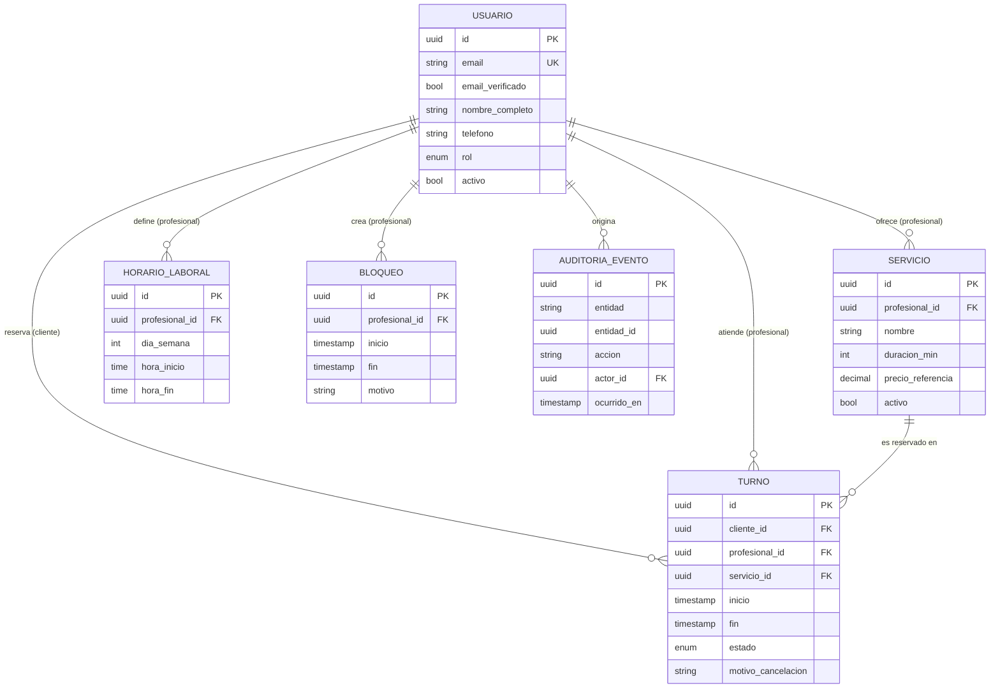

# spec.md — Sistema de Gestión de Turnos y Reservas de Servicios Profesionales

| Campo | Valor |
|---|---|
| Versión | 0.2.2 (MVP + Fase 2: backend y persistencia) |
| Estado | Borrador para revisión |
| Metodología | Spec-Driven Development (SDD) |
| Fecha | 2026-11-06 (v0.1.0: 2026-10-26) |

**Historial de cambios**

| Versión | Cambios |
|---|---|
| 0.1.0 | Spec inicial del MVP (prototipo conceptual con datos en memoria). |
| 0.2.0 | Se agrega **INV-03 (Persistencia real)** en §3 y los alias INV-01/INV-02. Se agrega el **contrato REST** en §11. Se agregan criterios de aceptación 9 a 13 en §8, las decisiones D-06 a D-09 en §9 (D-04 queda resuelta para la Fase 2) y filas de trazabilidad en §10. **No se modificó** el texto de RN-01 ni de RN-02, ni el modelo de datos de §4. |
| 0.2.1 | Se aprueban D-06, D-07, D-08 y D-09 (§9). D-08 se redefine: el frontend es `index.html` y conserva el catálogo como **datos mock**. D-07 queda resuelta con HTTP `422` sin código nuevo. Se actualizan las notas de §11 que citaban D-07. |
| 0.2.2 | Aclaración sin cambio de estructura: `HorarioLaboral.dia_semana` usa 0 = domingo … 6 = sábado, y `hora_inicio`/`hora_fin` son hora local `HH:MM` (§4.1). No se agregan entidades, atributos ni códigos de error. |

> Este documento es el **contrato del sistema**. Todo código, test y decisión de diseño debe poder trazarse a una sección de este archivo. Si el código y la spec divergen, se corrige primero la spec y luego el código.

Palabras clave normativas: **DEBE** (obligatorio), **NO DEBE** (prohibido), **PUEDE** (opcional), según RFC 2119.

---

## 1. Alcance del MVP

### 1.1 Objetivo
Permitir que clientes reserven turnos con profesionales para servicios con duración definida, y que los profesionales/administradores gestionen su agenda sin conflictos.

### 1.2 Incluido (In scope)

| ID | Capacidad |
|---|---|
| F-01 | Registro e inicio de sesión de usuarios (email + contraseña). |
| F-02 | Catálogo público de servicios (nombre, descripción, duración, precio de referencia, profesional). |
| F-03 | Consulta de disponibilidad por servicio y fecha (slots libres calculados). |
| F-04 | Reserva de turno por parte del Cliente. |
| F-05 | Consulta de "Mis turnos" (próximos e históricos) del Cliente. |
| F-06 | Cancelación de turno propio por el Cliente (sujeta a RN-01). |
| F-07 | Gestión de servicios por el Profesional (alta, edición, baja lógica). |
| F-08 | Definición de horario laboral semanal recurrente del Profesional. |
| F-09 | Bloqueo de rangos horarios (vacaciones, almuerzo, imprevistos). |
| F-10 | Vista de agenda diaria/semanal con todos los turnos del Profesional. |
| F-11 | Cancelación de turno por el Profesional/Administrador (sin restricción de ventana, con motivo). |
| F-12 | Métricas básicas: turnos por período, tasa de cancelación, servicios más reservados, ocupación. |
| F-13 | Notificación por email de confirmación y cancelación. |

### 1.3 Excluido (Out of scope)

- Pagos en línea, señas, reembolsos y facturación.
- Reprogramación directa de turnos (el MVP resuelve con cancelar + reservar nuevo).
- Turnos recurrentes / paquetes de sesiones.
- Lista de espera.
- Múltiples sucursales o recursos físicos (salas, equipos).
- Integración con calendarios externos (Google/Outlook), recordatorios por SMS/WhatsApp.
- Login social / SSO, autenticación multifactor.
- Aplicación móvil nativa (el MVP es web responsive).
- Multi-idioma y multi-moneda (MVP: español, una moneda).
- Reseñas y calificaciones.
- Multi-tenancy (una sola organización por despliegue).

### 1.4 Supuestos

- Una única zona horaria de operación por despliegue (configurable); los instantes se almacenan en UTC.
- Un turno pertenece a **un** profesional y **un** servicio.
- Un profesional atiende un solo turno a la vez (capacidad = 1).
- El cliente final reserva con cuenta registrada (no hay reserva anónima).

---

## 2. Matriz de Roles y Permisos (RBAC)

### 2.1 Roles

| Rol | Descripción |
|---|---|
| `CLIENTE` | Usuario final que reserva servicios. |
| `PROFESIONAL` | Presta servicios; administra su propia agenda y servicios. |
| `ADMIN` | Gestiona toda la operación: todos los profesionales, servicios y usuarios. |
| Anónimo | Visitante sin sesión (solo lectura del catálogo). |

> Para el MVP, `PROFESIONAL` y `ADMIN` comparten el panel de gestión; `ADMIN` amplía el alcance a **todos** los profesionales.

### 2.2 Matriz de permisos

Leyenda: ✅ permitido · ❌ prohibido · 🔒 solo sobre recursos propios

| Recurso / Acción | Anónimo | CLIENTE | PROFESIONAL | ADMIN |
|---|:-:|:-:|:-:|:-:|
| Ver catálogo de servicios | ✅ | ✅ | ✅ | ✅ |
| Ver disponibilidad (slots libres) | ✅ | ✅ | ✅ | ✅ |
| Registrarse / iniciar sesión | ✅ | — | — | — |
| Crear turno | ❌ | ✅ (para sí) | ❌ | ✅ (en nombre de un cliente) |
| Ver turno | ❌ | 🔒 | 🔒 (de su agenda) | ✅ |
| Cancelar turno | ❌ | 🔒 (sujeto a RN-01) | 🔒 (sin ventana mínima) | ✅ (sin ventana mínima) |
| Editar datos de contacto propios | ❌ | 🔒 | 🔒 | ✅ |
| Crear/editar/desactivar servicios | ❌ | ❌ | 🔒 | ✅ |
| Definir horario laboral | ❌ | ❌ | 🔒 | ✅ |
| Bloquear / desbloquear rangos horarios | ❌ | ❌ | 🔒 | ✅ |
| Ver agenda completa | ❌ | ❌ | 🔒 | ✅ |
| Ver métricas | ❌ | ❌ | 🔒 (propias) | ✅ (globales) |
| Gestionar usuarios y roles | ❌ | ❌ | ❌ | ✅ |

### 2.3 Reglas de autorización

- **RBAC-01**: Toda operación DEBE verificar rol **y** propiedad del recurso en el backend; la UI nunca es la barrera de seguridad.
- **RBAC-02**: Un acceso a un recurso ajeno DEBE responder `404` (no `403`) para no revelar su existencia a un `CLIENTE`.
- **RBAC-03**: El rol se asigna únicamente por un `ADMIN`; el auto-registro siempre crea `CLIENTE`.
- **RBAC-04**: Un `CLIENTE` NO DEBE poder ver datos de contacto de otros clientes. El `PROFESIONAL` solo ve los datos de contacto de clientes con turnos en su agenda.

---

## 3. Reglas Invariantes del Negocio

Las siguientes reglas son **no negociables**: se validan en el backend, y la base de datos DEBE reforzarlas con restricciones cuando sea técnicamente posible. Ninguna regla puede ser omitida por la UI ni por un rol (salvo excepción explícita indicada).

**Alias de la Fase 2.** Desde la v0.2.0 las reglas invariantes también se citan con el prefijo `INV-`. Los identificadores `RN-xx` se conservan porque `historias-de-usuario.md`, `tareas.md` e `index.html` los referencian; los `INV-xx` son alias, no reglas distintas.

| Alias | Regla | Estado |
|---|---|---|
| `INV-01` | RN-01 — Ventana mínima de cancelación (≥ 2 h) | Inmutable (texto sin cambios) |
| `INV-02` | RN-02 — Prohibición de doble reserva y solapamiento | Inmutable (texto sin cambios) |
| `INV-03` | Persistencia real (al final de esta sección) | Nueva en v0.2.0 |

### RN-01 — Ventana mínima de cancelación

- Un `CLIENTE` NO DEBE cancelar un turno si faltan **menos de 2 horas** para su `inicio`.
- Valor configurable (`CANCELLATION_WINDOW_HOURS`, default `2`); el cálculo usa `inicio - ahora(UTC)`.
- Un turno ya iniciado, finalizado o cancelado NO DEBE ser cancelable.
- **Excepción**: `PROFESIONAL`/`ADMIN` PUEDEN cancelar fuera de ventana, con motivo obligatorio, y el cliente DEBE ser notificado.
- Respuesta ante violación: error `CANCELLATION_WINDOW_EXPIRED` (HTTP 409).

### RN-02 — Prohibición de doble reserva y solapamiento

- Para un mismo profesional, dos turnos en estado activo (`CONFIRMADO`) NO DEBEN solaparse en el tiempo.
- Se define el solapamiento sobre intervalos semiabiertos `[inicio, fin)`: dos turnos A y B se solapan si `A.inicio < B.fin` **y** `B.inicio < A.fin`. Turnos contiguos (`A.fin == B.inicio`) son válidos.
- Un turno NO DEBE solaparse con un bloqueo horario (RN-05) ni quedar fuera del horario laboral del profesional.
- Un mismo cliente NO DEBE tener dos turnos activos solapados (aunque sean con distintos profesionales).
- **Garantía ante concurrencia**: la verificación DEBE ser atómica. Se exige restricción a nivel de base de datos (p. ej. `EXCLUDE USING gist` sobre rango temporal por profesional en PostgreSQL, o transacción con bloqueo + índice único equivalente). Una validación solo en la aplicación NO es suficiente.
- Los turnos `CANCELADO` NO participan del control de solapamiento (el slot se libera).
- Respuesta ante violación: error `SLOT_UNAVAILABLE` (HTTP 409).

### RN-03 — Validación obligatoria de datos de contacto

- Para crear un turno, el `CLIENTE` DEBE tener un perfil con: **nombre completo** (2–100 caracteres), **email válido** (RFC 5322 simplificado, único por usuario) y **teléfono** válido en formato E.164 o equivalente local normalizado.
- El email DEBE estar **verificado** (enlace de confirmación) antes de la primera reserva.
- La reserva NO DEBE persistirse si algún dato de contacto falta o es inválido (error `INVALID_CONTACT`, HTTP 422).
- Los datos se normalizan (trim, minúsculas en email, teléfono a E.164) antes de validar y guardar.

### RN-04 — Integridad temporal del turno

- `inicio` DEBE ser estrictamente futuro respecto a `ahora` al momento de crear el turno, con una **antelación mínima** configurable (default: 1 hora).
- `fin = inicio + duración del servicio`; el cliente NO DEBE enviar `fin` (se calcula en servidor).
- El `inicio` DEBE estar alineado a la grilla de slots del profesional (default: 15 min).
- Existe un **horizonte máximo de reserva** (default: 60 días).
- Todos los instantes se almacenan en UTC y se muestran en la zona horaria de operación.

### RN-05 — Bloqueos horarios

- Un bloqueo es un rango `[inicio, fin)` del profesional en el que no se pueden crear turnos.
- Crear un bloqueo sobre un rango con turnos activos DEBE ser rechazado con listado de conflictos, **salvo** que el profesional confirme cancelarlos (lo cual aplica la excepción de RN-01 y notifica a los clientes).

### RN-06 — Ciclo de vida del turno

Estados: `CONFIRMADO` → `CANCELADO` | `COMPLETADO` | `AUSENTE`.

| Transición | Quién | Condición |
|---|---|---|
| (nuevo) → `CONFIRMADO` | Cliente / Admin | Cumple RN-02, RN-03, RN-04 |
| `CONFIRMADO` → `CANCELADO` | Cliente | Cumple RN-01 |
| `CONFIRMADO` → `CANCELADO` | Profesional / Admin | Motivo obligatorio |
| `CONFIRMADO` → `COMPLETADO` | Profesional / Admin | `ahora ≥ inicio` |
| `CONFIRMADO` → `AUSENTE` | Profesional / Admin | `ahora ≥ fin` |

- Los estados `CANCELADO`, `COMPLETADO` y `AUSENTE` son **terminales**; ninguna transición sale de ellos.
- Un turno NO DEBE eliminarse físicamente; el historial es inmutable (solo cambia de estado).

### RN-07 — Integridad de catálogo

- Un servicio con turnos futuros activos NO DEBE eliminarse; solo desactivarse (baja lógica), lo cual impide nuevas reservas sin afectar las existentes.
- La duración de un servicio DEBE ser múltiplo de la grilla de slots y estar entre 15 min y 8 h.
- Modificar la duración de un servicio NO altera turnos ya confirmados.

### RN-08 — Trazabilidad

- Toda creación, cancelación y cambio de estado DEBE registrar: actor, rol, instante UTC y motivo (si aplica) en un log de auditoría inmutable.

### INV-03 — Persistencia real (Fase 2)

- **Persistencia relacional.** Todo `Turno`, y todo cambio de su `estado`, DEBE guardarse en una base de datos relacional. El sistema NO DEBE responder éxito (`200`/`201`) antes de que la transacción esté confirmada (`COMMIT`).
- **Atomicidad.** Cada operación de escritura (crear turno, cancelar turno) DEBE ejecutarse en **una sola transacción** que incluya el cambio del `Turno` y su `AuditoriaEvento` (RN-08). Si falla cualquier paso, NO DEBE quedar ningún cambio parcial (ni turno sin evento de auditoría, ni evento sin turno).
- **Durabilidad.** Los turnos DEBEN sobrevivir al reinicio del proceso backend y del equipo anfitrión. El estado de dominio NO DEBE tener como fuente de verdad la memoria del proceso del servidor ni la del navegador.
- **Fuente única.** El backend es el único escritor de la base de datos. El frontend NO DEBE escribir ni leer la base de datos directamente.
- **Motor en la Fase 2.** SQLite, en el archivo `turnos.db`, con claves foráneas activadas (`PRAGMA foreign_keys = ON`). Ver D-04 en §9 y las garantías de base de datos en §11.5.
- **Relación con otras reglas.** INV-03 es la condición que hace exigible RN-02 («verificación atómica») y RN-06 («un turno NO DEBE eliminarse físicamente»).
- **Respuesta ante fallo de persistencia.** HTTP `500`, sin persistir nada y sin informar el turno como confirmado.

---

## 4. Modelo de Datos Conceptual

### 4.1 Entidades principales

#### Usuario
| Atributo | Tipo | Restricciones |
|---|---|---|
| `id` | UUID | PK |
| `email` | texto | Único, obligatorio, normalizado |
| `email_verificado` | booleano | Default `false` |
| `password_hash` | texto | Obligatorio (nunca en claro) |
| `nombre_completo` | texto | Obligatorio, 2–100 |
| `telefono` | texto | Obligatorio, E.164 |
| `rol` | enum | `CLIENTE` \| `PROFESIONAL` \| `ADMIN` |
| `activo` | booleano | Default `true` |
| `creado_en` | timestamp UTC | |

#### Servicio
| Atributo | Tipo | Restricciones |
|---|---|---|
| `id` | UUID | PK |
| `profesional_id` | UUID | FK → Usuario (rol `PROFESIONAL`) |
| `nombre` | texto | Obligatorio |
| `descripcion` | texto | Opcional |
| `duracion_min` | entero | 15–480, múltiplo de la grilla |
| `precio_referencia` | decimal | ≥ 0, informativo |
| `activo` | booleano | Baja lógica (RN-07) |

#### Turno
| Atributo | Tipo | Restricciones |
|---|---|---|
| `id` | UUID | PK |
| `cliente_id` | UUID | FK → Usuario (rol `CLIENTE`) |
| `profesional_id` | UUID | FK → Usuario (rol `PROFESIONAL`) |
| `servicio_id` | UUID | FK → Servicio |
| `inicio` | timestamp UTC | Futuro al crear (RN-04) |
| `fin` | timestamp UTC | Calculado: `inicio + duración` |
| `estado` | enum | Ver RN-06 |
| `motivo_cancelacion` | texto | Obligatorio si lo cancela Profesional/Admin |
| `cancelado_por_id` | UUID | FK → Usuario, nullable |
| `creado_en` / `actualizado_en` | timestamp UTC | |

*Restricción clave*: exclusión de rangos `[inicio, fin)` por `profesional_id` cuando `estado = CONFIRMADO` (RN-02).

#### Entidades de soporte

| Entidad | Atributos clave | Propósito |
|---|---|---|
| **HorarioLaboral** | `id`, `profesional_id`, `dia_semana` (0–6; 0 = domingo, 6 = sábado), `hora_inicio`, `hora_fin` (hora local de la zona de operación, formato `HH:MM`) | Disponibilidad semanal recurrente (F-08). |
| **Bloqueo** | `id`, `profesional_id`, `inicio`, `fin`, `motivo` | Rangos no reservables (F-09, RN-05). |
| **AuditoriaEvento** | `id`, `entidad`, `entidad_id`, `accion`, `actor_id`, `rol`, `ocurrido_en`, `detalle` | Trazabilidad inmutable (RN-08). |

### 4.2 Relaciones y cardinalidad

```
Usuario (PROFESIONAL) 1 ──── N Servicio
Usuario (PROFESIONAL) 1 ──── N HorarioLaboral
Usuario (PROFESIONAL) 1 ──── N Bloqueo
Usuario (PROFESIONAL) 1 ──── N Turno      (como profesional atendiendo)
Usuario (CLIENTE)     1 ──── N Turno      (como cliente reservando)
Servicio              1 ──── N Turno
Usuario               1 ──── N AuditoriaEvento (actor)
```



### 4.3 Invariantes de integridad referencial

- `Turno.profesional_id` DEBE coincidir con `Servicio.profesional_id` del `servicio_id` asociado.
- `Turno.cliente_id` y `Turno.profesional_id` DEBEN ser usuarios distintos.
- Ninguna FK usa borrado en cascada sobre `Turno`; el historial se preserva (RN-06, RN-07).

---

## 5. Métricas del MVP (F-12)

| Métrica | Definición |
|---|---|
| Turnos por período | Conteo de turnos `CONFIRMADO`/`COMPLETADO` agrupados por día/semana/mes. |
| Tasa de cancelación | `CANCELADO / total creados` en el período, con desglose por quién canceló. |
| Tasa de ausentismo | `AUSENTE / (COMPLETADO + AUSENTE)`. |
| Ocupación | Minutos reservados / minutos disponibles (horario laboral − bloqueos). |
| Top servicios | Ranking de servicios por cantidad de turnos. |

Alcance: el `PROFESIONAL` ve solo las suyas; el `ADMIN` ve las globales y por profesional.

---

## 6. Requisitos No Funcionales (mínimos del MVP)

- **Seguridad**: contraseñas con hash adaptativo (argon2/bcrypt), HTTPS obligatorio, sesiones con expiración, protección CSRF/XSS, rate limiting en login y reserva.
- **Consistencia**: la creación de turno es transaccional y atómica (RN-02, INV-03).
- **Rendimiento**: consulta de disponibilidad < 500 ms p95 con hasta 50 profesionales.
- **Privacidad**: datos de contacto accesibles solo según RBAC-04; cumplimiento de la normativa local de protección de datos personales.
- **Disponibilidad**: objetivo 99,5 % mensual (sin HA en MVP).
- **Accesibilidad**: WCAG 2.1 AA en flujos de reserva.

---

## 7. Catálogo de Errores de Dominio

| Código | HTTP | Origen |
|---|---|---|
| `SLOT_UNAVAILABLE` | 409 | RN-02, RN-05 |
| `CANCELLATION_WINDOW_EXPIRED` | 409 | RN-01 |
| `INVALID_CONTACT` | 422 | RN-03 |
| `EMAIL_NOT_VERIFIED` | 403 | RN-03 |
| `INVALID_TIME_RANGE` | 422 | RN-04 |
| `INVALID_STATE_TRANSITION` | 409 | RN-06 |
| `SERVICE_HAS_ACTIVE_BOOKINGS` | 409 | RN-07 |
| `FORBIDDEN` / `NOT_FOUND` | 403 / 404 | RBAC-01, RBAC-02 |

---

## 8. Criterios de Aceptación (muestra Given/When/Then)

1. **Doble reserva**: *Dado* un turno `CONFIRMADO` de 10:00–10:30 con el profesional P, *cuando* otro cliente reserva 10:15–10:45 con P, *entonces* el sistema responde `SLOT_UNAVAILABLE` y no persiste nada.
2. **Concurrencia**: *Dado* dos solicitudes simultáneas por el mismo slot, *entonces* exactamente una se confirma y la otra recibe `SLOT_UNAVAILABLE`.
3. **Contigüidad**: *Dado* un turno 10:00–10:30, *cuando* se reserva 10:30–11:00, *entonces* se confirma.
4. **Cancelación en ventana**: *Dado* un turno que inicia en 3 h, *cuando* el cliente cancela, *entonces* pasa a `CANCELADO` y el slot queda libre.
5. **Cancelación fuera de ventana**: *Dado* un turno que inicia en 1 h 59 min, *cuando* el cliente cancela, *entonces* `CANCELLATION_WINDOW_EXPIRED`.
6. **Contacto inválido**: *Dado* un cliente sin teléfono válido, *cuando* intenta reservar, *entonces* `INVALID_CONTACT`.
7. **Aislamiento**: *Dado* el turno T del cliente A, *cuando* el cliente B consulta T, *entonces* recibe `404`.
8. **Bloqueo con conflicto**: *Dado* un turno confirmado dentro de un rango, *cuando* el profesional intenta bloquearlo sin confirmar, *entonces* el sistema lista los conflictos y no crea el bloqueo.

**Criterios agregados en v0.2.0 (Fase 2, se verifican contra la API de §11):**

9. **Persistencia tras reinicio (INV-03)**: *Dado* un turno creado con `POST /api/turnos` que respondió `201`, *cuando* se detiene y se vuelve a iniciar el backend, *entonces* `GET /api/turnos` devuelve ese turno con el mismo `id`, `inicio`, `fin` y `estado`.
10. **Atomicidad (INV-03)**: *Dado* que falla la escritura del `AuditoriaEvento` durante una creación o cancelación, *entonces* la transacción se revierte, el `Turno` queda como estaba antes de la solicitud y la API responde `500`.
11. **Concurrencia en base de datos (INV-02)**: *Dado* dos `POST /api/turnos` simultáneos por el mismo profesional y el mismo slot, *entonces* exactamente uno responde `201`, el otro responde `409 SLOT_UNAVAILABLE`, y la base de datos contiene un solo turno `CONFIRMADO` para ese rango.
12. **Cancelación vía API (INV-01)**: *Dado* un turno que inicia en 3 h, *cuando* su cliente invoca `POST /api/turnos/{id}/cancelar`, *entonces* responde `200` y el `estado` persistido es `CANCELADO`. *Dado* uno que inicia en 1 h 59 min, *entonces* responde `409 CANCELLATION_WINDOW_EXPIRED` y la fila no cambia (`estado` y `actualizado_en` intactos).
13. **La base de datos refuerza INV-02 por sí sola**: *Dado* un turno `CONFIRMADO` de 10:00–10:30 con el profesional P, *cuando* se intenta insertar directamente en la base de datos (sin pasar por la API) un turno `CONFIRMADO` de 10:15–10:45 con P, *entonces* la base de datos rechaza la inserción.

---

## 9. Decisiones Abiertas (a resolver antes de implementar)

| # | Pregunta | Propuesta por defecto |
|---|---|---|
| D-01 | ¿Un cliente puede tener límite de turnos activos simultáneos? | Sin límite en MVP |
| D-02 | ¿Los Profesionales pueden ser dados de alta por auto-registro? | No, solo vía `ADMIN` |
| D-03 | ¿Política de cancelaciones reiteradas / penalización? | Fuera del MVP |
| D-04 | Stack tecnológico y motor de BD (requiere soporte de exclusión de rangos) | **Resuelta para la Fase 2** (v0.2.0): backend Python + FastAPI y SQLite (`turnos.db`). SQLite no tiene `EXCLUDE USING gist`; RN-02 admite la alternativa «transacción con bloqueo + restricción equivalente», que se concreta en §11.5. PostgreSQL sigue siendo el motor propuesto para una versión productiva. |
| D-05 | ¿Confirmación automática o aprobación manual del profesional? | Automática |
| D-06 | **(v0.2.0)** El contrato REST de §11 no incluye autenticación (F-01 queda fuera de la Fase 2). ¿Cómo se identifica quién actúa? | El cuerpo de la solicitud informa el actor con campos que ya existen en `Turno` (`cliente_id` al crear, `actor_id` al cancelar, que se persiste en `cancelado_por_id`). **Limitación asumida:** RBAC-01 solo se puede verificar de forma parcial, porque el servidor no puede comprobar que quien llama es realmente ese usuario. Se resuelve cuando se incorpore F-01. **Aprobada el 2026-11-06.** |
| D-07 | **(v0.2.0)** El catálogo de errores de §7 no cubre dos casos: (a) cancelación por `PROFESIONAL`/`ADMIN` sin `motivo_cancelacion` (RN-01), y (b) reserva sobre un servicio con `activo = false` (RN-07). | **Aprobada el 2026-11-06.** Ambos casos se rechazan con HTTP `422` y el cuerpo de validación estándar de FastAPI (`{"detail": …}`), **sin código de dominio nuevo**: el catálogo de §7 no cambia. Si más adelante se quiere un código propio (por ejemplo para el servicio inactivo), se agrega primero a §7. |
| D-08 | **(v0.2.0)** Los 3 endpoints de §11 no exponen servicios, profesionales ni horarios. ¿De dónde obtiene el frontend el catálogo para armar la grilla de slots? | **Aprobada el 2026-11-06.** En la Fase 2 el frontend es `index.html` y conserva el catálogo (servicios, profesionales) y los horarios como **datos mock locales**, con los mismos `id` que la carga inicial de la base de datos. Calcula los slots con esos datos y con `GET /api/turnos`. El backend es la autoridad: siempre revalida y responde `SLOT_UNAVAILABLE` si el slot ya no está libre. Los datos mock se reemplazarán por endpoints de lectura en una fase posterior, que se agregarán primero a §11. |
| D-09 | **(v0.2.0)** ¿Qué reloj usa el backend? | El reloj real del sistema en UTC. El reloj simulado de la barra superior del prototipo no forma parte del contrato. Las pruebas del backend inyectan `ahora` como parámetro. **Aprobada el 2026-11-06.** |

---

## 10. Trazabilidad (Spec → Código → Test)

| Spec | Código (a completar) | Test (a completar) |
|---|---|---|
| RN-01 | — | Criterios 4, 5 |
| RN-02 | — | Criterios 1, 2, 3 |
| RN-03 | — | Criterio 6 |
| RBAC-02 | — | Criterio 7 |
| RN-05 | — | Criterio 8 |
| INV-01 (RN-01) vía `POST /api/turnos/{id}/cancelar` | — | Criterios 4, 5, 12 |
| INV-02 (RN-02) vía `POST /api/turnos` y restricción en BD | — | Criterios 1, 2, 3, 11, 13 |
| INV-03 | — | Criterios 9, 10 |
| §11 (contrato REST) | — | Criterios 9 a 13 |

---

## 11. Contrato de API REST (Fase 2)

Este contrato gobierna el backend. El frontend NO DEBE depender de nada que no esté escrito aquí. Si hace falta algo más, se agrega primero a este documento.

### 11.1 Alcance

- **Incluido:** listar turnos (F-05, parcial), crear reserva (F-04) y cancelar reserva (F-06 y F-11), con las reglas RN-01 a RN-04, RN-06 y RN-08 aplicadas en el servidor.
- **Excluido en la Fase 2:** autenticación y registro (F-01, ver D-06), catálogo y disponibilidad como endpoints (F-02, F-03; en la Fase 2 son datos mock del frontend, ver D-08), gestión de servicios y horarios (F-07, F-08), bloqueos (F-09), agenda, métricas (F-10, F-12), emails (F-13), completar o marcar ausente un turno, y reserva por un `ADMIN` en nombre de un cliente.
- **Persistencia:** el backend persiste únicamente las entidades de §4.1 (`Usuario`, `Servicio`, `Turno`, `HorarioLaboral`, `Bloqueo`, `AuditoriaEvento`). **No se crean entidades, tablas ni campos fuera de §4.1.**

### 11.2 Convenciones

| Aspecto | Definición |
|---|---|
| URL base | `http://localhost:8000` |
| Formato | JSON, UTF-8. `Content-Type: application/json`. |
| Nombres de campo | Exactamente los de §4.1 (`snake_case`, en español). |
| Identificadores | UUID en texto, generados por el servidor. |
| Instantes | ISO 8601 en UTC con sufijo `Z` (por ejemplo `2026-11-09T12:00:00Z`), de acuerdo con RN-04. |
| CORS | Habilitado, para que el frontend (que puede abrirse como archivo local) pueda llamar a la API. |
| Errores de dominio | Cuerpo `{"error": "<CÓDIGO>", "mensaje": "<texto>"}`, con el código y el HTTP del catálogo de §7. |

**Representación de un `Turno`** (todos los campos de §4.1, sin agregar ninguno):

```json
{
  "id": "0b6f8a52-6d6e-4a58-9f3e-2f1c7a3e9d10",
  "cliente_id": "…uuid…",
  "profesional_id": "…uuid…",
  "servicio_id": "…uuid…",
  "inicio": "2026-11-09T12:00:00Z",
  "fin": "2026-11-09T12:45:00Z",
  "estado": "CONFIRMADO",
  "motivo_cancelacion": null,
  "cancelado_por_id": null,
  "creado_en": "2026-11-06T15:20:11Z",
  "actualizado_en": "2026-11-06T15:20:11Z"
}
```

### 11.3 Resumen de endpoints

| Método | Ruta | Función | Éxito | Reglas |
|---|---|---|---|---|
| `GET` | `/api/turnos` | Listar turnos | `200` | RN-06 (el historial se conserva) |
| `POST` | `/api/turnos` | Crear reserva | `201` | RN-02, RN-03, RN-04, RN-08, INV-03 |
| `POST` | `/api/turnos/{id}/cancelar` | Cancelar reserva | `200` | **RN-01 (INV-01)**, RN-06, RN-08, INV-03 |

### 11.4 Detalle de cada endpoint

#### `GET /api/turnos`

- **Parámetros de consulta (opcionales, todos son campos de `Turno`):** `cliente_id`, `profesional_id`, `estado`.
- **Respuesta `200`:** lista JSON de `Turno`, ordenada por `inicio` ascendente. Incluye turnos en cualquier estado, porque no hay borrado físico (RN-06).
- **Nota:** sin autenticación (D-06), este endpoint no puede aplicar por sí solo RBAC-02 ni RBAC-04. Los filtros existen para que el frontend pida solo lo que necesita.

#### `POST /api/turnos`

- **Cuerpo:**

  | Campo | Tipo | Obligatorio | Nota |
  |---|---|:-:|---|
  | `cliente_id` | UUID | Sí | Debe corresponder a un `Usuario` con rol `CLIENTE`. |
  | `servicio_id` | UUID | Sí | De él se obtienen `profesional_id` y la duración (§4.3). |
  | `inicio` | timestamp UTC | Sí | Alineado a la grilla (RN-04). |

  El cliente NO envía `fin` ni `profesional_id` (RN-04, §4.3): el servidor los calcula. Tampoco envía `id`, `estado` ni marcas de tiempo.
- **Orden de evaluación:**
  1. Existencia de `cliente_id` y `servicio_id` → `404 NOT_FOUND`.
  2. Datos de contacto (RN-03) → `422 INVALID_CONTACT`; email sin verificar → `403 EMAIL_NOT_VERIFIED`.
  3. Integridad temporal (RN-04: futuro con antelación mínima, grilla, horizonte) → `422 INVALID_TIME_RANGE`.
  4. Disponibilidad (RN-02): solapamiento con otro turno `CONFIRMADO` del profesional, solapamiento con un turno `CONFIRMADO` del mismo cliente, solapamiento con un `Bloqueo`, o fuera del `HorarioLaboral` → `409 SLOT_UNAVAILABLE`.
- **Respuesta `201`:** el `Turno` creado, con `estado = "CONFIRMADO"`.
- **Efectos (una sola transacción, INV-03):** inserta el `Turno` y un `AuditoriaEvento` con `entidad = "Turno"` y `accion = "TURNO_CREADO"`.
- **Errores posibles:** `404 NOT_FOUND`, `422 INVALID_CONTACT`, `403 EMAIL_NOT_VERIFIED`, `422 INVALID_TIME_RANGE`, `409 SLOT_UNAVAILABLE`, `500` (INV-03). Una reserva sobre un servicio con `activo = false` se rechaza con `422` sin código de dominio (D-07).

#### `POST /api/turnos/{id}/cancelar`

- **Cuerpo:**

  | Campo | Tipo | Obligatorio | Nota |
  |---|---|:-:|---|
  | `actor_id` | UUID | Sí | Quien cancela. Se persiste en `Turno.cancelado_por_id` (ver D-06). |
  | `motivo_cancelacion` | texto | Solo si el actor es `PROFESIONAL` o `ADMIN` | Se persiste en `Turno.motivo_cancelacion`. |

- **Orden de evaluación:**
  1. El turno existe y el actor tiene acceso: es el `cliente_id` del turno, su `profesional_id`, o un `ADMIN`. Si no → `404 NOT_FOUND` (RBAC-02, no `403`).
  2. El `estado` es `CONFIRMADO`. Si no → `409 INVALID_STATE_TRANSITION` (RN-06).
  3. Si el actor es el `CLIENTE`: faltan al menos `CANCELLATION_WINDOW_HOURS` (default 2 h) para `inicio`. El límite exacto de 2 h se permite. Si faltan menos → `409 CANCELLATION_WINDOW_EXPIRED` (**INV-01**).
  4. Si el actor es `PROFESIONAL` o `ADMIN`: no se aplica la ventana, pero `motivo_cancelacion` es obligatorio (RN-01, excepción). Si falta, responde `422` sin código de dominio (D-07).
- **Respuesta `200`:** el `Turno` actualizado, con `estado = "CANCELADO"`, `cancelado_por_id`, `motivo_cancelacion` (si se envió) y `actualizado_en` nuevos.
- **Efectos (una sola transacción, INV-03):** actualiza el `Turno` e inserta un `AuditoriaEvento` con `entidad = "Turno"` y `accion = "TURNO_CANCELADO"`. El turno no se borra y el slot queda libre porque los `CANCELADO` no participan del control de solapamiento (RN-02).
- **Errores posibles:** `404 NOT_FOUND`, `409 INVALID_STATE_TRANSITION`, `409 CANCELLATION_WINDOW_EXPIRED`, `500` (INV-03).

### 11.5 Garantías en la base de datos (SQLite)

La base de datos refuerza las reglas por sí sola, sin depender de la aplicación (RN-02, INV-03):

| Garantía | Mecanismo |
|---|---|
| Esquema = §4.1 | Una tabla por entidad de §4.1, con exactamente sus atributos. Tipos: UUID, timestamps y enums como `TEXT`; booleanos como `INTEGER` 0/1; `decimal` como `NUMERIC`. |
| Enums y rangos | Restricciones `CHECK`: `rol`, `estado`, `duracion_min` (15–480), `dia_semana` (0–6), `fin > inicio`. |
| Integridad referencial | Claves foráneas activadas (`PRAGMA foreign_keys = ON`), sin `ON DELETE CASCADE` sobre `Turno` (§4.3). |
| No solapamiento (INV-02) | Un *trigger* que aborta el `INSERT`/`UPDATE` de un `Turno` con `estado = 'CONFIRMADO'` si ya existe otro `CONFIRMADO` del mismo `profesional_id` con `inicio < nuevo.fin` y `nuevo.inicio < fin`. Es la alternativa a `EXCLUDE USING gist` que admite RN-02. |
| Atomicidad ante concurrencia | Cada escritura usa una transacción `BEGIN IMMEDIATE`, que serializa a los escritores. La verificación de RN-02 y la inserción ocurren dentro de la misma transacción. |
| Historial inmutable (RN-06, RN-08) | El backend no emite `DELETE` sobre `Turno` ni sobre `AuditoriaEvento`. |

Un *trigger* es una restricción de la base de datos, no una entidad: no agrega tablas ni campos al modelo de §4.

### 11.6 Cambios futuros del contrato

Cualquier endpoint, campo, tabla o código de error nuevo DEBE incorporarse primero a este documento (y a §4 o §7 según corresponda) y recién después implementarse. Ver la directiva de abstención en [plan.md](plan.md) §7.
